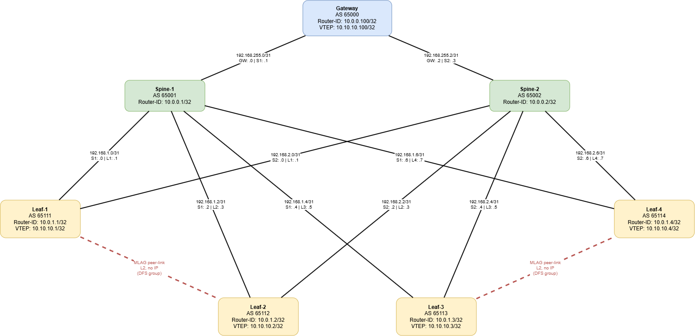

# Архитектура

## 1. Роли узлов

| Устройство | Роль | ASN |
|------------|------|-----|
| Gateway | Выход во внешние сети | 65000 |
| Spine-1 | Underlay spine | 65001 |
| Spine-2 | Underlay spine | 65001 |
| Leaf-1 | Leaf (MLAG-пара с Leaf-2) | 65111 |
| Leaf-2 | Leaf (MLAG-пара с Leaf-1) | 65112 |
| Leaf-3 | Leaf (MLAG-пара с Leaf-4) | 65113 |
| Leaf-4 | Leaf (MLAG-пара с Leaf-3) | 65114 |

Spine'ы используют общий ASN 65001 (ASN pre-planning, RFC 7938) - это упрощает ECMP

## 2. IP план
### Соединение Gateway и Spine
| Линк | Подсеть /31 | Сторона A | Сторона B |
|------|-------------|-----------|-----------|
| Gateway и Spine-1 | 192.168.255.0/31 | GW: 192.168.255.0 | Spine-1: 192.168.255.1 |
| Gateway и Spine-2 | 192.168.255.2/31 | GW: 192.168.255.2 | Spine-2: 192.168.255.3 |

### Соединение Spine и Leaf
| Устройства | Адресация | Spine | Leaf |
|------|-------------|---------|------|
| Spine-1 и Leaf-1 | 192.168.1.0/31 | 192.168.1.0 | 192.168.1.1 |
| Spine-1 и Leaf-2 | 192.168.1.2/31 | 192.168.1.2 | 192.168.1.3 |
| Spine-1 и Leaf-3 | 192.168.1.4/31 | 192.168.1.4 | 192.168.1.5 |
| Spine-1 и Leaf-4 | 192.168.1.6/31 | 192.168.1.6 | 192.168.1.7 |
| Spine-2 и Leaf-1 | 192.168.2.0/31 | 192.168.2.0 | 192.168.2.1 |
| Spine-2 и Leaf-2 | 192.168.2.2/31 | 192.168.2.2 | 192.168.2.3 |
| Spine-2 и Leaf-3 | 192.168.2.4/31 | 192.168.2.4 | 192.168.2.5 |
| Spine-2 и Leaf-4 | 192.168.2.6/31 | 192.168.2.6 | 192.168.2.7 |
### Loopback (Router-ID)

Router-ID Spine и Gateway в `10.0.0.0/24`.
Router-ID Leaf в `10.0.1.0/24`.

| Устройство | Loopback |
|------------|----------|
| Gateway | 10.0.0.100/32 |
| Spine-1 | 10.0.0.1/32 |
| Spine-2 | 10.0.0.2/32 |
| Leaf-1 | 10.0.1.1/32 |
| Leaf-2 | 10.0.1.2/32 |
| Leaf-3 | 10.0.1.3/32 |
| Leaf-4 | 10.0.1.4/32 |
### Loopback VTEP

| Устройство | VTEP loopback |
|------------|---------------|
| Gateway | 10.10.10.100/32 |
| Leaf-1 | 10.10.10.1/32 |
| Leaf-2 | 10.10.10.2/32 |
| Leaf-3 | 10.10.10.3/32 |
| Leaf-4 | 10.10.10.4/32 |

## 3. Overlay: EVPN/VXLAN

Раздел будет заполнен на этапе overlay: iBGP EVPN между Leaf'ами и Gateway,
Type-2/3/5, Anycast Gateway.

## 4. Multi-tenancy (VRF)

Раздел будет заполнен на этапе multi-tenancy: VRF `tenant-a` и `tenant-b`
с пересекающейся подсетью `172.16.10.0/24`, L3VNI.

## 5. VNI / VRF таблица

Заполняется на этапе overlay/multi-tenancy.

## 6. OOB-управление

Раздел будет заполнен на этапе OOB: VRF `mgmt`, сеть `192.168.100.0/24`,
адреса устройств.

## 7. Хосты

Раздел будет заполнен на этапе dataplane: 6 хостов, включая EVPN MH (All-Active)
и MLAG.